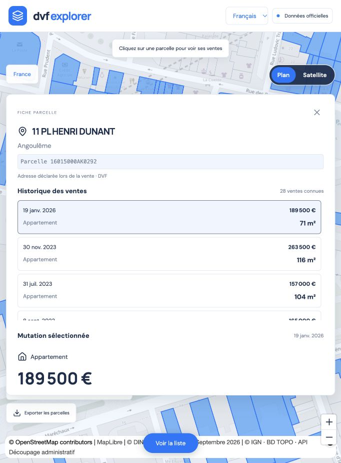

# DVF Explorer

Explore French property sales using Cerema DVF+ open data, with a React + TypeScript frontend, MapLibre maps, a FastAPI API and DuckDB queries over published Parquet files. The map starts around Angoulême and automatically loads sales in the visible extent as you pan and zoom. All archived years are selected by default.



## Quick start

```sh
git clone https://github.com/ddecrulle/dvf-explorer.git
cd dvf-explorer
python3 -m venv .venv
.venv/bin/python -m pip install -r backend/requirements.lock.txt
cd frontend
npm ci
npm run build
cd ..
.venv/bin/python -m uvicorn main:app --app-dir backend --host 127.0.0.1 --port 8000
```

Open http://127.0.0.1:8000. On macOS, `Launch.command` also installs missing dependencies, builds a missing frontend and starts the server. Keep its terminal open; press Ctrl+C to stop. After changing frontend sources, run `npm run build` again.

Use Python 3.15 and Node 24 LTS (or a supported newer Node release). The Docker runtime uses Python 3.15.0 in a minimal Chainguard image pinned by digest; Node 24 LTS is used only to compile the frontend. See [runtime security](docs/runtime-security.md) for compatibility, scans and updates.

A fresh clone reads the public dataset on SSPCloud S3: **sales are available at startup, without an import**. Internet access is required. The API applies filters and computes statistics directly over prepared Parquet partitions; the browser never needs S3 credentials. A locally prepared `data/published/current.json` takes precedence when no dataset URL is configured.

Use `DVF_DATASET_URL` to select another published dataset, or `DVF_DATASET_URL=local` to explicitly enable the legacy DGFiP/DuckDB importer. See [published data and the separate DVF+ worker](docs/s3-parquet.md) for preparation, updates, local snapshots, private buckets and recovery.

## Source code

The repository contains readable sources, not the production bundle. Vite generates `frontend/dist/` during the build; Git ignores this directory, `node_modules/`, `.venv/` and all local data.

```text
frontend/src/
  main.tsx                  Application entry point
  App.tsx                   Search, filters and page composition
  types.ts                  API and domain types
  api.ts                    HTTP client and error handling
  format.ts                 Display formatting and CSV export
  mapData.ts                GeoJSON generation and default location
  components/
    SaleCard.tsx            Sale list item
    SaleDetails.tsx         Selected sale details
    DataPanel.tsx           Archive coverage and import controls
  hooks/useSalesMap.ts       Map lifecycle and source updates
  style.css                 Formatted application styles
backend/
  main.py                   API routes, authentication and legacy background jobs
  dataset.py                Immutable published-release reads and geographic pruning
  object_store.py           S3/HTTP reads and server-only credential configuration
  dvfplus.py                Official DVF+ CSV normalization and coordinate conversion
  update_dataset.py         Separate resumable DVF+ preparation/publication worker
  publish.py                Validated Parquet export and atomic publication
  archive.py                Immutable ZIP archives and publication snapshots
  national.py               Streaming imports and period replacement
  ingest.py                 Raw DVF normalization and targeted imports
  geocode.py                Department-level parcel matching
  sync.py                   Nationwide orchestration and writer lock
  store.py                  DuckDB connection and schema
  rebuild.py                Offline reconstruction from archives
  sync_remote.py            Kubernetes HTTP sync client
```

TypeScript uses strict checking. UI text, documentation, comments and application messages are in English. Official French source columns, category values, municipality names and addresses retain their original meaning; property categories are translated for display only.

## Using the explorer

- Search for an address or municipality and select an IGN suggestion.
- Pan and zoom to explore; sales and statistics follow the visible map. Filter by year, property type, price and dates.
- Select a sale in the list or map to view its source, parcels and details.
- Nearby sales are grouped at wider zoom levels; click a group to zoom into individual sales. Dense groups include every matching transaction, even when the list is limited to the latest 3,000.
- Export the displayed selection as CSV, up to 3,000 rows.
- Use **Official data** to inspect publication coverage. Published mode has no import controls.
- On small screens, use the bottom button to switch between map and list.

The previous-year comparison uses the same visible extent, price and type filters but the **entire previous year**, ignoring date filters. It is not a comparison of equal-length periods. Near a department boundary, import neighbouring departments too if using targeted imports.

## Ingestion and permanent history

The default DVF+ pipeline uses Cerema mutation identifiers and existing geolocation. It runs separately from the web application and publishes immutable Parquet releases. CSV exports lack street addresses and exact room counts; municipality names are supplemented using the official geographic API, with source codes retained for historical municipalities. Price/m² is restricted to one-premise, one-parcel transactions. The following raw DVF pipeline remains available only in legacy mode.

See [the ingestion guide](docs/ingestion.md) for the full pipeline, correction rules, resume behaviour and reconstruction steps.

All official ZIPs are archived before the query database changes. New publications replace only their declared coverage period in DuckDB. Older years remain available after the publisher removes them. Raw archives preserve all source rows; the explorer exposes positive-price sales only.

The downloaded October 2026 publication covers the second half of 2021, full years 2022–2025 and the first half of 2026. Earlier retired years cannot be recovered from this publication alone; they need another verifiable archive. Late registrations can be absent even within published periods.

## Interpretation and limitations

In legacy raw-DVF mode, the raw files do not provide a unique public transaction identifier. Adjacent rows with matching department, document/reference, date, nature, amount, municipality and disposition are grouped. Distinct sales can be ambiguous; multi-municipality or multi-disposition transactions can be split. Counts represent inferred positive-price `Vente` disposition groups, not a certified number of deeds.

Prices are counted once per group, never summed across repeated rows. In legacy mode, a map point is inside one matched parcel; DVF+ mode uses Cerema coordinates. A multi-parcel sale may extend beyond the visible map. Missing or renumbered parcels can leave sales unlocated: those sales remain in import counts but are absent from the map.

For complex groups with multiple parcels or building signatures, floor area, rooms and price/m² are not consolidated. Even simple groups can hide identical but distinct buildings. Land area is deduplicated by parcel and land-use attributes and remains declarative. A house price may include outbuildings. Medians are not property valuations.

DVF does not cover Alsace, Moselle or Mayotte. Respect the source terms, including restrictions on re-identification. The UI requests `noindex`; this is not an access-control mechanism. Data are distributed under the Open Licence 2.0.

Sources: [DGFiP DVF](https://www.data.gouv.fr/datasets/demandes-de-valeurs-foncieres), [Etalab cadastre](https://cadastre.data.gouv.fr/datasets/cadastre-etalab), [IGN address search](https://data.geopf.fr/geocodage/search).

## Development and checks

Run the API as above, then start Vite in a second terminal:

```sh
cd frontend
npm ci
npm run dev
npm run typecheck
npm test
npm run format:check
npm run build
```

See [the frontend guide](docs/frontend.md) for component boundaries, query lifetimes and tests.

Vite proxies `/api` to port 8000. Production builds are served by FastAPI. Backend checks, from the repository root:

```sh
.venv/bin/python -m pytest backend/tests -q
```

Format frontend changes with `npm run format` from `frontend/`. Python sources follow Ruff's formatter; install the pinned development tools in `backend/requirements-dev.txt` and run `.venv/bin/ruff format backend`.

In legacy local mode, only one process may write the DuckDB file. Do not run CLI imports while the API is using the same database. Read endpoints are unauthenticated. Imports and sync require `DVF_ADMIN_TOKEN` when configured; without it, writes are restricted to loopback clients and local origins.

Internet access is required for basemaps, address search and source downloads. Already imported sales do not depend on the source publication remaining online. DuckDB defaults to a 2 GB memory budget and two threads, configurable through `DVF_MEMORY_LIMIT` and `DVF_THREADS`.

## Docker and Kubernetes

Run `docker compose up --build` to consult the public dataset. For custom settings, copy `.env.example` to `.env`; never commit it. Compose persists local snapshots in `data/` and binds the app to localhost. Legacy mode requires `DVF_DATASET_URL=local` and a random `DVF_ADMIN_TOKEN` for imports.

Use the [Helm chart](charts/README.md) to deploy the React frontend and Python API together on SSPCloud. See [CI and image publication](docs/ci.md) for Docker Hub images and chart packages. No CronJob is required to serve published DVF+ datasets from S3; dataset preparation and publication run separately. The SSPCloud example uses one replica and a persistent volume for BAN indexes and caches. GitHub Actions does not deploy to the cluster automatically.

## S3 and Parquet

The default web application reads prepared sales from S3 without a local import. Each visit pins one immutable release and reads only partitions whose year and geographic bounds intersect the search. DuckDB applies map bounds and filter predicates and computes medians before the 3,000-row display limit.

See [the S3/Parquet guide](docs/s3-parquet.md) for the separate worker, raw archives, immutable releases, private access and deployment. `DVF_ARCHIVE_DIR` remains a filesystem setting for the legacy importer.

## Parcel energy diagnostics

Open a sale detail to consult DPE diagnostics on its cadastral parcel. Lookup uses ADEME and IGN, with a 24-hour server cache and explicit matching confidence. Current labels do not certify the DPE supplied at the sale. See [sources, matching rules and limitations](docs/dpe.md).

## Parcel history

Map points and list cards represent cadastral parcels. Open a parcel to see its known positive-price mutations across all years in the visit’s published dataset, independently of the current map filters. Select a mutation to see its original amount, involved parcels and DPE evidence as of its date. Multiple sales on a parcel do not necessarily concern the same dwelling. Prices involving several parcels remain whole-transaction amounts. See [frontend architecture and history rules](docs/frontend.md#parcel-entry-point-and-mutation-history).

Les parcelles sont enrichies avec les adresses actuelles explicitement reliées dans la Base Adresse Nationale. L'index départemental persiste sur le volume de données et peut être préparé avant l'ouverture de l'application. Voir [la correspondance adresses–parcelles](docs/addresses.md) pour les sources, les limites et la commande d'actualisation.
