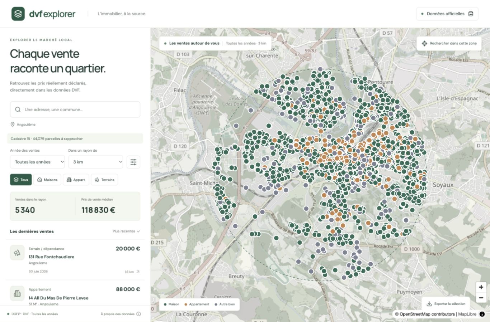

# DVF Explorer

Application locale React + MapLibre + FastAPI + DuckDB. Les ventes proviennent des fichiers bruts officiels DGFiP, sans attendre leur intégration dans une API tierce. La carte démarre autour d’Angoulême, avec un rayon de 3 km modifiable.



## Installation depuis GitHub

```sh
git clone https://github.com/ddecrulle/dvf-explorer.git
cd dvf-explorer
```

Les données et dépendances ne sont pas versionnées. Après le premier lancement, ouvrir **Données officielles** et cliquer sur **Synchroniser la France entière**. L’application archive tous les fichiers publiés, importe les ventes de tous les départements, puis rapproche les parcelles cadastrales. Les fichiers restent dans `data/`, hors Git. Une interruption se reprend en relançant la synchronisation.

## Ouvrir l’application

Sur macOS, double-cliquer sur **Lancer.command**, puis ouvrir http://127.0.0.1:8000. Garder la fenêtre du terminal ouverte. Arrêter avec Ctrl+C.

Python 3.14 et Node 22.12+ sont recommandés pour une installation neuve (versions utilisées pour les vérifications locales : Python 3.14 et Node 26). Le script installe les dépendances manquantes. Si le port est occupé, arrêter l’ancienne instance avant de relancer.

Avec Docker : copier `.env.example` vers `.env`, définir `DVF_ADMIN_TOKEN` avec un jeton aléatoire, puis exécuter `docker compose up --build`. Utiliser la même adresse locale et saisir ce jeton dans « Données officielles » pour synchroniser. Ne pas partager ni versionner `.env`. La construction de l’image Docker a été vérifiée localement ; le déploiement Kubernetes reste à effectuer. Elle conserve les données dans `data/` et n’expose le service que sur la machine locale.

## Utilisation

- Chercher une adresse ou une commune et sélectionner une suggestion IGN.
- Afficher **Toutes les années** (par défaut) ou choisir un millésime, puis filtrer le rayon, le type, le prix ou les dates.
- Cliquer une vente dans la liste ou un point sur la carte pour voir son détail.
- Déplacer la carte puis cliquer « Rechercher dans cette zone » pour recentrer le rayon.
- Exporter les résultats affichés en CSV (maximum 3 000 lignes).
- Ouvrir « Données officielles » pour lancer la synchronisation nationale ou un import ciblé. Un seul import fonctionne à la fois ; le navigateur peut être fermé pendant son exécution, à condition de laisser le serveur tourner.
- Sur téléphone, basculer entre carte et liste avec le bouton inférieur.

Un clone GitHub démarre sans données. La synchronisation France importe tous les départements présents dans les fichiers officiels. Les ventes apparaissent sur la carte progressivement pendant le rapprochement cadastral. Une recherche d’adresse fonctionne partout où le service IGN répond. Une recherche proche d’une frontière départementale nécessite d’importer aussi les départements voisins.

## Provenance et interprétation

Source : [DGFiP, Demandes de valeurs foncières](https://www.data.gouv.fr/datasets/demandes-de-valeurs-foncieres), publication du 12 octobre 2026 ; [cadastre Etalab](https://cadastre.data.gouv.fr/datasets/cadastre-etalab) ; recherche [Géoplateforme IGN](https://data.geopf.fr/geocodage/search).

La publication du 12 octobre 2026 contient le second semestre 2021, les années 2022 à 2025 et le premier semestre 2026. Les années antérieures déjà retirées ne sont pas récupérables depuis cette seule publication. Elles nécessitent une autre archive vérifiable. La comparaison affichée entre années reprend le même rayon, les mêmes bornes de prix et le même type, mais **pas les filtres de dates** : ce n’est pas une comparaison de volumes à périodes équivalentes. Les enregistrements tardifs peuvent manquer, même sur un semestre publié.

Le fichier brut ne contient pas d’identifiant public unique de mutation. L’import regroupe les lignes contiguës ayant document/référence, date, nature, montant, commune et numéro de disposition identiques. Cette méthode est une approximation : deux ventes distinctes présentant les mêmes caractéristiques peuvent être confondues ; une mutation multi-communes ou multi-dispositions peut être séparée. Le compteur correspond à des groupes de dispositions de nature « Vente », de montant strictement positif. Les autres natures de mutation sont exclues. Ne pas interpréter le compteur comme un nombre certifié d’actes notariés.

Le montant est pris une fois par groupe, jamais additionné par ligne. Le point est un point intérieur d’une des parcelles retrouvées ; une vente multi-parcelles peut dépasser le rayon même si sa parcelle représentative y figure. Les parcelles disparues ou renumérotées peuvent rester sans coordonnées et sont alors absentes de la carte. Leur nombre reste visible par différence entre ventes importées et localisées.

Pour les groupes complexes (plusieurs parcelles ou plusieurs signatures de local), surface bâtie, pièces et prix au m² ne sont pas consolidés. Même un groupe simple peut masquer des locaux distincts de caractéristiques identiques. Les surfaces terrain sont dédupliquées par parcelle et culture ; elles restent déclaratives. Une dépendance peut être associée au montant d’une maison : le prix/m² n’est donc pas un prix hors dépendances. Les médianes ne constituent pas une estimation immobilière.

Le rapprochement cadastral utilise le millésime `latest` au premier téléchargement, conservé en cache. Pour actualiser les parcelles, arrêter le serveur, supprimer le fichier `data/cadastre-DEPARTEMENT.json.gz`, relancer et réimporter. Le fichier DVF est identifié en cache par ressource et date de publication. L’import vérifie les dates puis remplace uniquement la période annoncée par la ressource dans une transaction atomique. Les mois et années en dehors de cette période sont préservés.

Licence Ouverte 2.0 pour les données. Pas de recherche de personnes ni d’indexation externe ; les métadonnées de l’interface demandent `noindex`. DVF ne couvre pas l’Alsace, la Moselle et Mayotte.

## Développement

```sh
# Depuis le dossier de l’application
python3 -m venv .venv
.venv/bin/python -m pip install -r backend/requirements.lock.txt
.venv/bin/python -m uvicorn main:app --app-dir backend --host 127.0.0.1 --port 8000
# Dans un second terminal
cd frontend
npm ci
npm run dev
```

Vite redirige `/api` vers le port 8000. Pour la version compilée : `cd frontend && npm run build`, puis redémarrer FastAPI. Lancer les tests depuis le dossier principal avec `.venv/bin/python -m pytest backend/tests -q`.

Import en ligne de commande, serveur arrêté :

```sh
.venv/bin/python backend/ingest.py --department 16 --year 2026
```

Ne pas lancer plusieurs processus d’écriture sur le même fichier DuckDB : un serveur unique est prévu. Les lectures de données sont sans authentification. Les écritures (`/api/import`, `/api/sync`) exigent `DVF_ADMIN_TOKEN` quand il est configuré ; sinon elles sont limitées aux appels locaux et aux origines locales. Pour le cluster, le jeton est obligatoire. Les imports téléchargent un fichier national et un cadastre départemental ; prévoir de l’espace et de la mémoire pour les départements volumineux. La carte, le géocodage et les imports nécessitent Internet. Les ventes importées restent consultables en liste hors connexion.


## Archive nationale cumulative

`backend/archive.py` conserve chaque contenu ZIP sous son empreinte SHA-256, avec les métadonnées de la ressource et un instantané du catalogue. Une nouvelle version n'écrase jamais l'ancienne archive. La vérification de changement se fonde sur l'identifiant, l'URL, la date de modification, le titre, la taille et le checksum annoncés par le producteur ; une modification silencieuse ne modifiant aucun de ces champs peut ne pas être détectée. Les empreintes des archives locales sont revérifiées avant leur réutilisation.

La base consultable utilise la dernière version intégrée de chaque période. Si le producteur retire une année du catalogue, aucune suppression locale n'a lieu. Si un fichier annuel devient un fichier « second semestre », le premier semestre déjà conservé reste présent. Seules les ventes à valeur positive sont proposées dans l'explorateur ; les autres lignes restent disponibles dans les archives brutes intactes.

Les fichiers sont d'abord tous archivés, puis importés par flux, un millésime à la fois. Chaque millésime est validé et intégré atomiquement. La géolocalisation vient ensuite, département par département. Les échecs de cadastre ne suppriment pas les ventes ; le statut signale les départements à reprendre. Les compteurs de ventes importées et localisées restent distincts.

Les parcelles sans correspondance restent non localisées : parcelles disparues, renumérotées, hors cadastre disponible. Après un rapprochement réussi, les départements dont la liste des parcelles n'a pas changé sont ignorés lors des synchronisations suivantes. Pour forcer un nouveau rapprochement cadastral, serveur arrêté, effacer l'entrée de ce département dans la table `geocoding` et supprimer son éventuel fichier cadastral en cache avant de relancer. Les coordonnées déjà connues restent disponibles.

Le fichier `data/job.json` conserve la progression. Après un redémarrage, une tâche restée active est signalée comme interrompue et peut être relancée. Les étapes réussies sont réutilisées. Les fichiers temporaires des imports interrompus peuvent être retirés de `data/staging/` **serveur arrêté** ; ne jamais supprimer `data/archives/`.

Pour une synchronisation en ligne de commande, serveur arrêté :

```sh
.venv/bin/python backend/sync.py
# Archiver et importer les ventes sans télécharger les cadastres :
.venv/bin/python backend/sync.py --no-geocode
```

DuckDB dispose par défaut d'un budget mémoire de 2 Go et de deux threads. Ajuster `DVF_MEMORY_LIMIT` et `DVF_THREADS` selon le serveur. Un seul processus doit ouvrir la base en écriture. La lecture de cadastre se fait par flux ; seuls les identifiants de parcelles utiles sont conservés en mémoire.

## Vérification quotidienne sur Kubernetes

Voir [les manifestes et leur guide](deploy/kubernetes/README.md). Le CronJob prévu à 03:00 Europe/Paris appelle l'API protégée, qui reste l'unique écrivain DuckDB. Il ne devient actif qu'après déploiement. Le PVC conserve les archives à travers les redémarrages ; prévoir également une sauvegarde indépendante du cluster. Aucun bucket S3, cluster ou registre Docker Hub n'est configuré automatiquement.


## Reconstruire depuis les archives, sans le producteur

Serveur arrêté, choisir un **nouveau dossier de données vide** avec `DVF_DATA_DIR` et pointer `DVF_ARCHIVE_DIR` vers le dossier d'archives restauré. Lancer `python backend/rebuild.py`. Les instantanés sont rejoués chronologiquement ; la commande refuse une base contenant déjà des ventes. Les coordonnées cadastrales doivent ensuite être rapprochées à nouveau, sauf si la base complète a été restaurée depuis une sauvegarde. Cette opération ne nécessite pas data.gouv pour réimporter les ventes.
